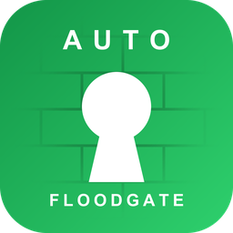

# FloodPass

**AuthMe 的 Floodgate Auto Login（基岩版自动登录）附属：Xbox 验证 · 全自动 · 零输入**

[English](https://github.com/Dalict/FloodPass/blob/main/README.md) | [简体中文](https://github.com/Dalict/FloodPass/blob/main/README_CN.md)

> **仅适用于官方版 AuthMe。** FloodPass 面向原版 [AuthMeReloaded](https://github.com/AuthMe/AuthMeReloaded)（5.x / 6.x）。请勿安装在已内置 Floodgate 自动登录的分支（如 [AuthMeReReloaded](https://github.com/HaHaWTH/AuthMeReReloaded)）上——功能会重复执行。

## 插件定位

互通服务器通常用 AuthMe 保护生存账号。这对 Java 玩家没问题，但通过 Geyser + Floodgate 接入的基岩玩家在连接建立之前就已经用微软 / Xbox 账户证明了自己的身份。再逼他们用手柄键盘输一遍密码，既没有增加安全性，又徒增麻烦。

FloodPass 补上这个缺口：

- **对基岩玩家**：从头到尾什么都不用输。已注册的账号在进服约一秒后自动登录；全新玩家静默地以随机密码注册并直接登录
- **对 Java 玩家**：零影响，照常走 AuthMe 原有流程
- **前缀兼容**：带 Floodgate 前缀的基岩名（如 `.Steve`）无需改动 AuthMe 的 `allowedNicknameCharacters` 默认正则即可进服——只豁免真正的 Floodgate UUID，正则对 Java 玩家照常生效
- **与 /premium 共存**：基岩玩家的游戏 ID 与已启用正版验证（`/premium`，AuthMe 6.x + PacketEvents）的 Java 账号同名时，基岩侧照常进服、Java 侧保留免密正版登录
- **对服主**：一个 jar，不需要改任何 AuthMe 配置，一条命令管理全部；信任判断交还给本该负责的一方（Floodgate 的 Xbox Live 验证）

一句话：**Floodgate 认可的玩家，FloodPass 直接放行。**

## 工作原理

1. 玩家进服，FloodPass 以 `MONITOR` 优先级监听，此时该连接的 Floodgate 身份数据已经就绪
2. 用 `FloodgateApi#isFloodgatePlayer(uuid)` 判断是否真正的基岩连接；Java 玩家不安排任何任务，完全不受影响
3. 等待可配置的延迟（默认 20 tick），让 AuthMe 完成它自己的进服处理（limbo 建立、会话恢复），然后 FloodPass 接管：
   - 已注册玩家：`AuthMeApi#forceLogin` 免密码登录
   - 未注册玩家（开启自动注册时）：`AuthMeApi#forceRegister` 以随机密码注册并立即登录

**安全性依据**：Floodgate 身份只有在基岩客户端通过有效的 Xbox Live 令牌完成 Floodgate 加密握手之后才会存在。Java 版客户端无法伪造该身份，所以免密通道只对"微软已经验证过"的玩家开放。

## 兼容性

| 组件 | 要求 | 说明 |
|------|------|------|
| 服务端 | Spigot / Paper / Purpur / Folia 1.13+ | Java 8 字节码；更老的传统服务端（1.8+）一般也能加载，未测试 |
| Folia | 支持 | 通过反射使用实体调度器，其他环境自动回退全局调度器 |
| Java | 8+ | 实际下限通常由你安装的 AuthMe/Floodgate 决定，而不是 FloodPass |
| AuthMe | 5.2+（v3 API） | **仅限官方 AuthMeReloaded**；已在 5.6.x 与 6.0.x 上验证 |
| Floodgate | 2.x | 加载期硬依赖 |

## 安装

1. 安装并配置好 **Geyser** 与 **Floodgate**（2.x），确保基岩玩家可以进服
2. 安装**官方版 AuthMe**（AuthMeReloaded，5.2+），按 Java 玩家的需要正常配置
3. 把 `FloodPass-x.x.x.jar` 放进 `plugins/` 并重启服务器
4. 完成。不需要改 AuthMe 任何设置；两份内置语言文件会在首次启动时释放

> 用一个基岩账号验证：首次进服应提示"已通过 Xbox Live 验证，自动注册并登录成功"，再次进服提示"自动登录成功"。

## 命令与权限

| 命令 | 权限 | 说明 |
|------|------|------|
| `/floodpass` | `floodpass.admin`（默认 OP） | 查看状态（启用、延迟、自动注册） |
| `/floodpass reload` | `floodpass.admin` | 重载 config.yml 与当前语言文件 |

别名：`/fpass`

## 配置

| 选项 | 默认值 | 说明 |
|------|--------|------|
| `language` | `en` | 使用 `lang/` 目录下的哪份 `messages_<语言>.yml`（内置 en 与 zh_cn；自行添加任意语言文件同样生效） |
| `enabled` | `true` | 自动登录总开关 |
| `login-delay-ticks` | `20` | 进服后等待多少 tick 再登录；建议不低于 10 |
| `auto-register.enabled` | `true` | 自动注册首次进服的基岩玩家；关闭后走 AuthMe 正常注册流程 |
| `auto-register.password-length` | `32` | 随机注册密码长度（8-64）；基岩玩家永远不需要知道它 |
| `bypass-nickname-check` | `true` | 恢复被 AuthMe 的 `allowedNicknameCharacters` 在预登录阶段拒绝的基岩玩家；只豁免真正的 Floodgate UUID，Java 玩家仍按正则校验 |
| `premium-conflict-guard` | `true` | 基岩玩家游戏 ID 与已注册 premium 的 Java 账号同名时仍可进服（AuthMe 6.x + PacketEvents） |
| `debug` | `false` | 在控制台记录每一次登录决策 |

玩家消息存放在 `lang/` 目录下的独立文件中，支持 `&` 颜色代码；自定义文件缺失的键自动回落英文。

## 已知限制

- 基岩账号以带 Floodgate 前缀的名字存储（默认前缀下如 `.Steve`）。**日后修改 Floodgate 用户名前缀会破坏既有账号的名字映射**，需要迁移 AuthMe 数据
- `bypass-nickname-check` 依靠踢出消息中内嵌的正则来识别 AuthMe 的拒绝；若自定义了 AuthMe 的 `invalid_name_characters` 消息，请保留 `%reg` 标签
- 若 Floodgate 的 `username-prefix` 为空，同名碰撞防护无法区分两种身份——且 AuthMe 本身也会把两个账号存为同名，该场景不受支持
- `forceLogin` 会绕过该基岩账号的 AuthMe 两步验证。对 Xbox 已验证身份而言这是预期行为
- 在开启实验性 Dialog 登录界面的 AuthMe 6.x（Minecraft 1.21.6+）上，基岩玩家可能在延迟自动登录完成前看到登录弹窗一闪而过
- AuthMe 的 `/premium` 命令面向 Java 正版账号，普通基岩玩家使用会被安全拒绝；基岩玩家也不需要它——FloodPass 已自动登录

## 下载

最新版本：[https://github.com/Dalict/FloodPass/releases](https://github.com/Dalict/FloodPass/releases)

## 支持

- 问题反馈：[https://github.com/Dalict/FloodPass/issues](https://github.com/Dalict/FloodPass/issues)
- 源码仓库：[https://github.com/Dalict/FloodPass](https://github.com/Dalict/FloodPass)
- 开源协议：[MIT](https://github.com/Dalict/FloodPass/blob/main/LICENSE)

## 作者

Dalict — [https://github.com/Dalict](https://github.com/Dalict)
