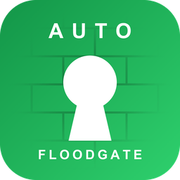
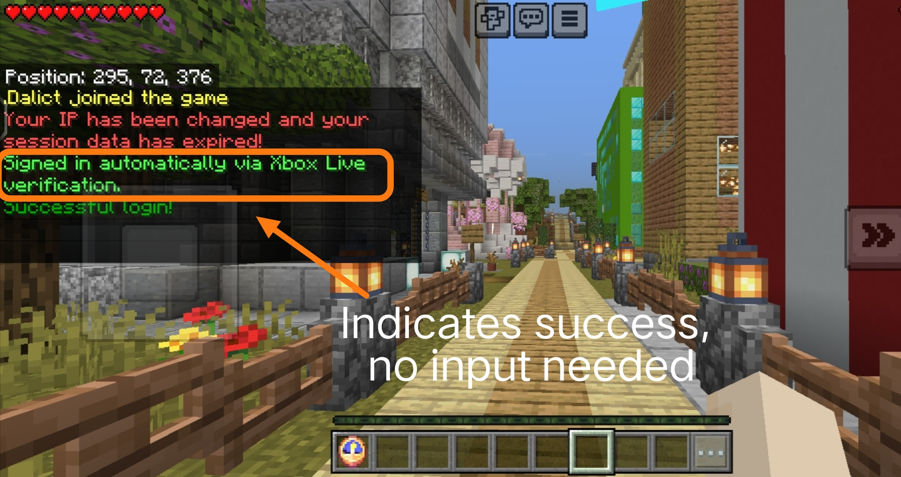

    <a href="README.md">English</a> | <a href="README_CN.md">简体中文</a>

<h1 align="center">FloodPass</h1>

Floodgate Auto Login for AuthMe — Xbox-verified, so Bedrock players never type a password

    
    
    
     
    
    
     
    
    
    
    
    

> **Official AuthMe only.** FloodPass is built for the original
> [AuthMeReloaded](https://github.com/AuthMe/AuthMeReloaded) (5.x / 6.x).
> It is **not** intended for forks that already ship native Floodgate
> auto-login, such as [AuthMeReReloaded](https://github.com/HaHaWTH/AuthMeReReloaded).
> On such forks the feature would run twice — do not install FloodPass there.

---

## What It Does

Cross-play servers usually protect survival accounts with AuthMe. That works well for Java players, but Bedrock players arriving through Geyser + Floodgate have already proven who they are: they signed in with their Microsoft/Xbox account before the connection was even established. Making them type a password anyway is simply unnecessary.

FloodPass solves exactly that:

- **For Bedrock players**: nothing to type, ever. Registered accounts are signed in automatically about a second after joining; brand-new players are registered silently with a random password and signed in the same way
- **For Java players**: zero change, they go through AuthMe exactly as before
- **Prefix-friendly**: Bedrock names carrying the Floodgate prefix (for example `.Steve`) pass AuthMe's default `allowedNicknameCharacters` regex without any AuthMe config change — only genuine Floodgate UUIDs are exempt, the regex still applies to Java players unchanged
- **Premium coexistence**: a Bedrock player whose gamertag equals a premium-enrolled Java account (`/premium`, AuthMe 6.x + PacketEvents) joins normally while the Java account keeps its passwordless premium login — both identities, one name, no conflict
- **For server owners**: one jar, no AuthMe configuration changes, one command to manage everything; the trust decision stays where it belongs (Floodgate's Xbox Live verification)

In one sentence: **a player verified by Floodgate goes straight in, without AuthMe password login.**

---

## Screenshot of a Bedrock Player Joining

---

## How It Works

1. A player joins; FloodPass listens at `MONITOR` priority, by which time Floodgate identity data for the connection is available
2. `FloodgateApi#isFloodgatePlayer(uuid)` decides whether this is a genuine Bedrock connection; Java players schedule nothing and are never touched
3. After a configurable delay (20 ticks by default), AuthMe has finished its own join processing (limbo setup, session resume), and FloodPass takes over:
   - Registered player: `AuthMeApi#forceLogin` signs the account in without a password
   - Unregistered player (if auto-register is on): `AuthMeApi#forceRegister` registers the account with a random password and signs it in immediately

**Security basis**: a Floodgate identity only exists after the Bedrock client completed Floodgate's encrypted handshake with a valid Xbox Live token. A Java Edition client cannot forge that identity, so the passwordless path is only ever offered to players Microsoft has already verified. This holds as long as the Floodgate private key (`key.pem`) stays private and all Bedrock traffic enters through Geyser.

**Nickname prefix support**: AuthMe's pre-login check rejects names not matching `allowedNicknameCharacters` (default `[a-zA-Z0-9_]*`), which would block every prefixed Bedrock name before any login plugin could act. FloodPass re-examines that deny at pre-login and restores admission when the connection carries a genuine Floodgate UUID — mirroring what Bedrock-aware AuthMe forks patch in natively (`bypass-nickname-check`).

**Premium name-collision guard**: AuthMe 6.x premium verification intercepts the login packet and challenges connections whose wire name matches a premium-enrolled account; a Bedrock player with the same gamertag carries that raw name in the packet and could never pass the Mojang challenge. FloodPass listens at `LOWEST` priority (before AuthMe's `NORMAL`), detects verified Floodgate connections through Floodgate's own `floodgate-player` channel attribute (only set after Xbox-signed data was decrypted), and rewrites the wire username to `prefix + name`. AuthMe's own username filter then skips the connection, Floodgate builds the final identity from its verified data, and the collision disappears — the Java account keeps premium, the Bedrock player joins via Xbox verification (`premium-conflict-guard`, needs PacketEvents).

---

## Compatibility

| Component | Requirement | Notes |
|-----------|-------------|-------|
| Server | Spigot / Paper / Purpur / Folia 1.13+ | Compiled as Java 8 bytecode; older legacy servers (1.8+) generally load it too, untested |
| Folia | Supported | Uses the per-entity scheduler via reflection, falls back to the global scheduler elsewhere |
| Java | 8+ | The JVM floor is usually raised by AuthMe/Floodgate builds, not by FloodPass |
| AuthMe | 5.2+ (v3 API) | **Official AuthMeReloaded only**; tested against 5.6.x and 6.0.x. Not for forks with built-in Bedrock auto-login (see notice above) |
| Floodgate | 2.x | Required at load time (`depend`) |

---

## Dependencies

| Plugin | Required | Version | Purpose |
|--------|----------|---------|---------|
| [Floodgate](https://geysermc.org/download/floodgate/) | Required | 2.x | Verifies Bedrock players through Xbox Live; the trust basis of every FloodPass feature |
| [AuthMe](https://www.spigotmc.org/resources/authmereloaded.6269/) (official [AuthMeReloaded](https://github.com/AuthMe/AuthMeReloaded)) | Required | 5.2+ | The login plugin FloodPass signs Bedrock players into; forks with built-in Bedrock auto-login are not supported |
| [PacketEvents](https://github.com/retrooper/packetevents) | Optional | 2.x | Only needed when AuthMe 6.x premium verification (`enablePremium`) is used |

> Geyser itself is not a plugin dependency of FloodPass — Bedrock connectivity can come from any Geyser setup (standalone or proxy), but the Floodgate plugin must run on this server.

---

## Installation

1. Install and configure **Geyser** and **Floodgate** (2.x) so Bedrock players can join
2. Install the **official AuthMe** (AuthMeReloaded, 5.2+); configure it as usual for your Java players — forks with native Floodgate auto-login should not add FloodPass on top
3. Drop `FloodPass-x.x.x.jar` into `plugins/` and restart the server
4. Done. No AuthMe settings need to change; both bundled language files are extracted on first start

> Verify with a Bedrock account: first join should say "Registered and signed in automatically", the next join "Signed in automatically".

---

## Commands and Permissions

| Command | Permission | Description |
|---------|------------|-------------|
| `/floodpass` | `floodpass.admin` (default OP) | Show status (enabled, delay, auto-register) |
| `/floodpass reload` | `floodpass.admin` | Reload config.yml and the active language file |

Alias: `/fpass`

---

## Design Notes

- **Delayed execution instead of join-time forcing**: calling `AuthMeApi#forceLogin` directly inside `PlayerJoinEvent` races against AuthMe's own asynchronous join processing. FloodPass waits (20 ticks by default), which mirrors the approach of AuthMe forks with native Bedrock support, and the delay is why `login-delay-ticks` should not be lowered carelessly
- **Only stable API surface**: the plugin restricts itself to `isRegistered`, `isAuthenticated`, `forceLogin` and `forceRegister`, whose signatures are identical in AuthMe 5.2 through 6.x, so one build serves every AuthMe generation without reflection against AuthMe itself
- **Random passwords are never shown**: an auto-registered Bedrock account has a 32-character password nobody knows, which is intentional. The account is only reachable through Xbox verification or the server operator. Owners who want a Bedrock player to also log in from Java can set a real password with AuthMe's admin commands
- **Reflection only where it is safe**: the single reflective call targets Paper/Folia's entity scheduler with a `NoSuchMethod` fallback to the global scheduler, giving Folia support without breaking older Spigot builds
- **Pre-login re-allow instead of config patching**: relaxing `allowedNicknameCharacters` globally would let Java players spoof dotted names; instead FloodPass inspects AuthMe's deny (result `KICK_OTHER`, kick message embedding the configured pattern, xuid-derived UUID) and restores admission only for that exact case, so the regex keeps protecting Java players
- **Collision guard rides AuthMe's own skip path**: the guard does not fight AuthMe's premium interceptor — it rewrites the login-packet username of cryptographically verified Floodgate connections so AuthMe's built-in username filter declines the name itself. Floodgate then constructs the identity from its verified data (the wire username is never used), which is why the rewrite cannot produce double prefixes, and the `floodgate-player` channel attribute guarantees Java connections are never touched

## Known Limitations

- Bedrock accounts are stored under their Floodgate-prefixed name (for example `.Steve` with the default prefix). **Changing the Floodgate username prefix later breaks the name mapping** for existing accounts and requires an AuthMe database migration — or you can simply leave it as is: the player is automatically re-registered with a fresh random password
- `bypass-nickname-check` recognizes AuthMe's deny by the pattern embedded in its kick message; if you customize AuthMe's `invalid_name_characters` message, keep the `%reg` tag so detection continues to work
- With an empty Floodgate `username-prefix` the premium conflict guard cannot tell the two identities apart — and AuthMe itself would store both accounts under the same name, which is unsupported
- AuthMe's nickname length limits (`maxNickLength`, default 20) are not bypassed; prefixed Bedrock names (prefix + 16-char gamertag = 17 max) fit the default
- `forceLogin` bypasses AuthMe's two-factor authentication for Bedrock accounts. For an Xbox-verified identity this is the intended behavior, but be aware it applies to Bedrock accounts with 2FA enabled as well
- On AuthMe 6.x with the experimental dialog login UI (Minecraft 1.21.6+), a Bedrock player may see the login dialog flash briefly before the delayed auto sign-in completes
- Session resume, proxies and BungeeCord messaging are untouched; if AuthMe already signed the player in through a session, FloodPass detects it and stays idle
- AuthMe's `/premium` command targets Java accounts and is safely rejected for regular Bedrock players (their Floodgate-prefixed name matches no Mojang account). Bedrock players do not need it — FloodPass already signs them in; when a gamertag collides with a premium-enrolled Java account, `premium-conflict-guard` keeps the Bedrock side joinable

---

## License

MIT License, see [LICENSE](LICENSE).

## Support and Feedback

I hope this plugin helps you all! I built it because I run a cross-play server and want to keep using the official AuthMe. If you run into anything, please do leave feedback — thank you! ouo

- Issues: [GitHub Issues](https://github.com/Dalict/FloodPass/issues)
- Repository: [https://github.com/Dalict/FloodPass](https://github.com/Dalict/FloodPass)
