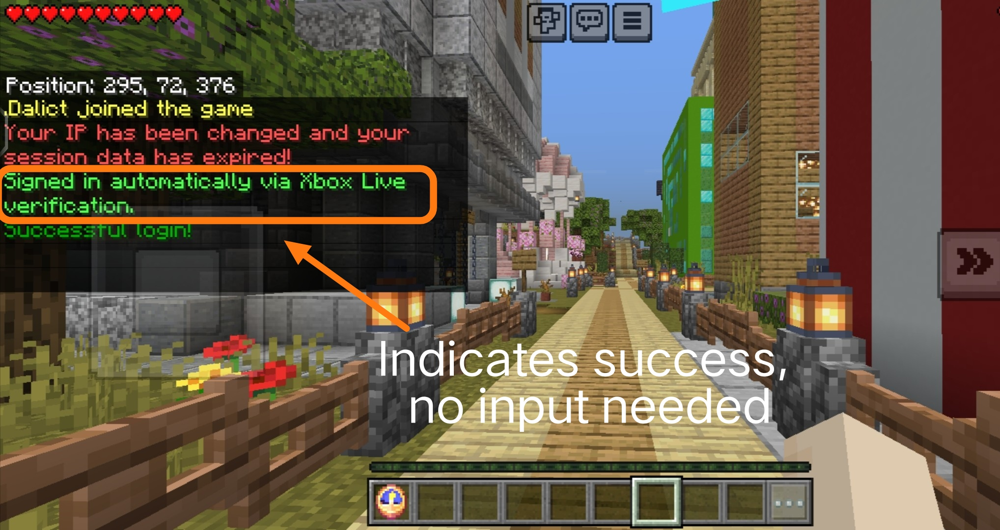

# FloodPass

---

[简体中文](https://github.com/Dalict/FloodPass/blob/main/README_CN.md)

An AuthMe addon (Floodgate Auto Login) that lets Bedrock players join an AuthMe + Geyser + Floodgate Java server without typing a password.

---

## What It Does

Offline-mode servers usually protect survival accounts with AuthMe, which is fine for Java players. But if your server also runs cross-play through Geyser + Floodgate, Bedrock players have already proven who they are before the connection is established. Asking them to type a login or register password on top of that is simply unnecessary.

FloodPass fills exactly that gap:

- **For Bedrock players**: nothing to type, ever. Registered accounts sign in automatically about a second after joining; brand-new players are registered silently with a random password and signed in right away
- **For Java players**: no impact at all, they keep using AuthMe exactly as before
- **Prefix-friendly**: names with the Floodgate prefix (for example `.Steve`) join without touching AuthMe's default `allowedNicknameCharacters` regex — only genuine Floodgate UUIDs are exempt, and the regex still applies to Java players
- **Works with /premium**: when a Bedrock gamertag collides with a premium-enrolled Java account (`/premium`, AuthMe 6.x + PacketEvents), both sides can still join — one name, two identities, no conflict
- **Pre-join dialog aware**: even if AuthMe 6.x enables its blocking pre-join dialog (`settings.registration.dialog.preJoin`), FloodPass approves it for verified Bedrock players through AuthMe's own API — no password dialog, and no AuthMe config change

**A player verified by Floodgate goes straight in, without AuthMe password login.**

---

## Screenshot of a Bedrock Player Joining

---

## Compatibility

| Component | Requirement | Notes |
|---|---|---|
| Server | Spigot / Paper / Purpur / Folia 1.13+ | Java 8 bytecode; older legacy servers (1.8+) generally load it, untested |
| Folia | Supported | Per-entity scheduler via reflection, global scheduler fallback elsewhere |
| AuthMe | 5.2+ (v3 API) | **AuthMeReloaded**; tested against 5.6.x and 6.0.x |
| Floodgate | 2.x | Hard dependency at load time (`depend`) |

> FloodPass is not a proxy plugin, but it also works on proxy-based servers. See https://github.com/Dalict/FloodPass/blob/main/WIKI.md#proxies-velocity--bungeecord for details.

## Dependencies

| Plugin | Required | Version | Purpose |
|---|---|---|---|
| [Floodgate](https://geysermc.org/download/floodgate/) | Required | 2.x | Verifies Bedrock players through Xbox Live; the trust basis of every FloodPass feature |
| [AuthMe](https://www.spigotmc.org/resources/authmereloaded.6269/) (official [AuthMeReloaded](https://github.com/AuthMe/AuthMeReloaded)) | Required | 5.2+ | The login plugin FloodPass signs Bedrock players into; the official version is recommended |
| [PacketEvents](https://github.com/retrooper/packetevents) | Optional | 2.x | Only needed when AuthMe 6.x premium verification (`enablePremium`) is used |

> Geyser itself is not a plugin dependency of FloodPass — Bedrock connectivity can come from any Geyser setup (standalone or proxy), but the Floodgate plugin must run on this server.

>
> **Best suited to the official AuthMe.** FloodPass targets the original [AuthMeReloaded](https://github.com/AuthMe/AuthMeReloaded) (5.x / 6.x) and **also works with forks that ship built-in Floodgate auto-login** (such as [AuthMeReReloaded](https://github.com/HaHaWTH/AuthMeReReloaded)) — it generally works and brings the auto-registration benefit. Their built-in feature is disabled by default; if you enable it, do not use FloodPass.

---

## Wiki & Feedback

- Wiki: https://github.com/Dalict/FloodPass/blob/main/WIKI.md
- Feedback: https://github.com/Dalict/FloodPass/issues

I hope this plugin helps you. I built it because my own server is cross-play and I wanted to keep using the official AuthMe. If you run into anything, please leave feedback — thank you! ouo
