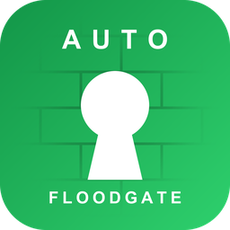
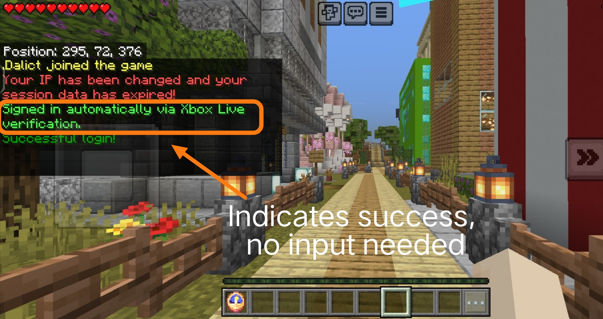

    <a href="README.md">English</a> | <a href="README_CN.md">简体中文</a>

<h1 align="center">FloodPass</h1>

AuthMe 的 Floodgate Auto Login（基岩版自动登录）附属：Xbox 验证 让基岩版无需输入密码

    
    
    
     
    
    
     
    
    
    
    
    

> **仅适用于官方版 AuthMe。** FloodPass 面向原版
> [AuthMeReloaded](https://github.com/AuthMe/AuthMeReloaded)（5.x / 6.x），
> **不适用于已内置 Floodgate 自动登录的分支**（如
> [AuthMeReReloaded](https://github.com/HaHaWTH/AuthMeReReloaded)）——
> 在这类分支上功能会重复执行，请勿同时安装。

---

## 插件定位

互通服务器通常用 AuthMe 保护生存账号。这对 Java 玩家没问题，但通过 Geyser + Floodgate 接入的基岩玩家在连接建立之前就已经用微软 / Xbox 账户证明了自己的身份。还要让他们输一遍密码，多此一举。

FloodPass 就补上了这个问题：

- **对基岩玩家**：从头到尾什么都不用输。已注册的账号在进服约一秒后自动登录；全新玩家静默地以随机密码注册并直接登录
- **对 Java 玩家**：零影响，照常走 AuthMe 原有流程
- **前缀兼容**：带 Floodgate 前缀的基岩名（如 `.Steve`）无需改动 AuthMe 的 `allowedNicknameCharacters` 默认正则即可进服——只豁免真正的 Floodgate UUID，正则对 Java 玩家照常生效
- **与 /premium 共存**：基岩玩家的游戏 ID 与已启用正版验证（`/premium`，AuthMe 6.x + PacketEvents）的 Java 账号同名时，基岩侧照常进服、Java 侧保留免密正版登录——一个名字两种身份，互不冲突
- **对服主**：一个 jar，不需要改任何 AuthMe 配置，一条命令管理全部；信任判断交还给本该负责的一方（Floodgate 的 Xbox Live 验证）

一句话：**Floodgate 认证的玩家，FloodPass 直接放行，不经过 AuthMe 密码登录**

---

## 基岩版玩家加入的效果图

---

## 工作原理

1. 玩家进服，FloodPass 以 `MONITOR` 优先级监听，此时该连接的 Floodgate 身份数据已经就绪。
2. 用 `FloodgateApi#isFloodgatePlayer(uuid)` 判断是否真正的基岩连接；Java 玩家不安排任何任务，完全不受影响
3. 等待可配置的延迟（默认 20 tick），让 AuthMe 完成它自己的进服处理（limbo 建立、会话恢复），然后 FloodPass 接管：
   - 已注册玩家：`AuthMeApi#forceLogin` 免密码登录
   - 未注册玩家（开启自动注册时）：`AuthMeApi#forceRegister` 以随机密码注册并立即登录

**安全性依据**：Floodgate 身份只有在基岩客户端通过有效的 Xbox Live 令牌完成 Floodgate 加密握手之后才会存在。Java 版客户端无法伪造该身份，所以免密通道只对"微软已经验证过"的玩家开放。前提是 Floodgate 私钥（`key.pem`）不外泄、基岩流量全部经 Geyser 进入。

**名字前缀支持**：AuthMe 的预登录校验会拒绝不匹配 `allowedNicknameCharacters`（默认 `[a-zA-Z0-9_]*`）的名字，任何登录类插件都来不及介入。FloodPass 会在预登录阶段复核该拒绝，当连接持有真正的 Floodgate UUID 时恢复放行——与具备基岩能力的 AuthMe 分支的原生补丁效果一致（`bypass-nickname-check`）。

**同名碰撞防护**：AuthMe 6.x 的正版验证会在封包层拦截登录包，对名字命中 premium 注册账号的连接发起 Mojang 加密挑战；同名基岩玩家在包里携带的正是裸游戏 ID，永远无法通过挑战。FloodPass 以 `LOWEST` 优先级监听（先于 AuthMe 的 `NORMAL`），通过 Floodgate 自己的 `floodgate-player` 渠道属性识别"已通过 Xbox 签名数据解密验证"的连接，把包内用户名改写为 `前缀+名字`——AuthMe 自己的用户名过滤器随即跳过该连接，Floodgate 再用验证数据构造最终身份，碰撞消失：Java 账号保留 premium，基岩玩家经 Xbox 验证进服（`premium-conflict-guard`，需 PacketEvents）。

---

## 兼容性

| 组件 | 要求 | 说明 |
|------|------|------|
| 服务端 | Spigot / Paper / Purpur / Folia 1.13+ | Java 8 字节码；更老的传统服务端（1.8+）一般也能加载，未测试 |
| Folia | 支持 | 通过反射使用实体调度器，其他环境自动回退全局调度器 |
| Java | 8+ | 实际下限通常由你安装的 AuthMe/Floodgate 决定，而不是 FloodPass |
| AuthMe | 5.2+（v3 API） | **仅限官方 AuthMeReloaded**；已在 5.6.x 与 6.0.x 上验证。不适用于内置基岩自动登录的分支（见顶部说明） |
| Floodgate | 2.x | 加载期硬依赖（`depend`） |

---

## 依赖插件

| 插件 | 是否必需 | 版本 | 用途 |
|------|----------|------|------|
| [Floodgate](https://geysermc.org/download/floodgate/) | 必需 | 2.x | 通过 Xbox Live 验证基岩玩家身份，是 FloodPass 所有功能的信任基础 |
| [AuthMe](https://www.spigotmc.org/resources/authmereloaded.6269/)（官方 [AuthMeReloaded](https://github.com/AuthMe/AuthMeReloaded)） | 必需 | 5.2+ | FloodPass 为基岩玩家登录的目标登录插件；内置基岩自动登录的分支不受支持 |
| [PacketEvents](https://github.com/retrooper/packetevents) | 可选 | 2.x | 仅在使用 AuthMe 6.x 正版验证（`enablePremium`）时需要 |

> Geyser 本身不是 FloodPass 的插件依赖——基岩连接可以来自任意 Geyser 部署形态（独立端或代理端），但 Floodgate 插件必须运行在本服务器上。

---

## 安装

1. 安装并配置好 **Geyser** 与 **Floodgate**（2.x），确保基岩玩家可以进服
2. 安装**官方版 AuthMe**（AuthMeReloaded，5.2+），按 Java 玩家的需要正常配置——已内置基岩自动登录的分支不要再叠加 FloodPass
3. 把 `FloodPass-x.x.x.jar` 放进 `plugins/` 并重启服务器
4. 完成。不需要改 AuthMe 任何设置；两份内置语言文件会在首次启动时释放

> 用一个基岩账号验证：首次进服应提示"自动注册并登录成功"，再次进服提示"自动登录成功"。

---

## 代理网络（Velocity / BungeeCord）怎么装

问得最多的问题，一次说清楚。

FloodPass 不是代理插件。别放进 Velocity 或 BungeeCord 的 plugins 文件夹，放进去也不会加载。它跟着 AuthMe 走：AuthMe 在哪台后端，它就装哪台后端。

各组件的位置：

| 组件 | 代理端 | 后端（跑 AuthMe 的服务器） |
|------|--------|--------------------------|
| Geyser | 装 | 不装 |
| Floodgate | 装 | **也要装**（key.pem 和代理端同一把） |
| AuthMe | 不装 | 装 |
| FloodPass | 不装 | 装 |

为什么后端也要一个 Floodgate？代理端的 Floodgate 只负责把基岩玩家的身份加密转发过来，真正解开这份身份、让后端插件认出"这是基岩玩家"的，是后端自己那份 Floodgate。只在前端装 Floodgate，后端插件认不出基岩玩家，别的要适配基岩的后端插件也是同一个道理。

key.pem 的处理：把代理端 Floodgate 的 key.pem 复制一份，放进每个后端 Floodgate 的文件夹，两边文件必须一模一样。

另外两件小事：

- Velocity 记得开 modern forwarding，后端 Paper 的 forwarding-secret 要和它对上，不然身份传不到后端
- 用了 AuthMe 的 /premium 的话，代理端还要装官方的 authme-velocity，后端 AuthMe 里配 `Hooks.bungeecord: true` 和同一个 `proxySharedSecret`

装完拿基岩客户端连 Geyser 的端口（默认 UDP 19132），进服一秒左右看到自动登录的提示就成了。

---

## 命令与权限

| 命令 | 权限 | 说明 |
|------|------|------|
| `/floodpass` | `floodpass.admin`（默认 OP） | 查看状态（启用、延迟、自动注册） |
| `/floodpass reload` | `floodpass.admin` | 重载 config.yml 与当前语言文件 |

别名：`/fpass`

---

## 设计说明

- **延迟执行而非进服瞬间强登**：在 `PlayerJoinEvent` 里直接调 `AuthMeApi#forceLogin` 会与 AuthMe 自身的异步进服处理竞争。FloodPass 等待（默认 20 tick），与具备原生基岩支持的 AuthMe 分支做法一致——这也是不建议随意调低 `login-delay-ticks` 的原因
- **只用稳定 API 面**：插件只调用 `isRegistered`、`isAuthenticated`、`forceLogin`、`forceRegister`，它们在 AuthMe 5.2 到 6.x 之间签名完全一致，因此一个构建通吃所有 AuthMe 版本，无需对 AuthMe 做任何反射
- **随机密码永不展示**：自动注册的基岩账号使用 32 位无人知晓的随机密码，这是有意为之。该账号只能通过 Xbox 验证或服主操作触达。如果希望某个基岩玩家也能用 Java 版登录同名账号，可用 AuthMe 管理命令为其设置真正的密码
- **反射只用在安全处**：唯一一处反射针对 Paper/Folia 的实体调度器，`NoSuchMethod` 时回退全局调度器，既支持 Folia 又不破坏老 Spigot
- **预登录复核而非放宽正则**：全局放宽 `allowedNicknameCharacters` 会让 Java 玩家也能使用带点的名字（冒充基岩身份）；FloodPass 改为精确识别 AuthMe 的那次拒绝（结果 `KICK_OTHER`、踢出消息内嵌配置正则、UUID 由 XUID 派生），仅对这一种情形恢复放行，正则对 Java 玩家的保护原样保留
- **碰撞防护借力 AuthMe 自己的跳过路径**：防护不与 AuthMe 的 premium 拦截器对抗，只是把"已通过加密验证的 Floodgate 连接"的登录包用户名改写，让 AuthMe 内置的用户名过滤器自行放弃该名字。Floodgate 随后用验证数据构造身份（包内用户名从不参与），因此改写不可能产生双前缀；`floodgate-player` 渠道属性保证 Java 连接零干扰

## 已知限制

- 基岩账号以带 Floodgate 前缀的名字存储（默认前缀下如 `.Steve`）。**日后修改 Floodgate 用户名前缀会破坏既有账号的名字映射**，需要迁移 AuthMe 数据，或者不用理它，自动随机密码注册。
- `bypass-nickname-check` 依靠踢出消息中内嵌的正则来识别 AuthMe 的拒绝；若你自定义了 AuthMe 的 `invalid_name_characters` 消息，请保留 `%reg` 标签，否则识别将失效
- 若 Floodgate 的 `username-prefix` 为空，同名碰撞防护无法区分两种身份——且 AuthMe 本身也会把两个账号存为同名，该场景不受支持
- AuthMe 的昵称长度上限（`maxNickLength`，默认 20）不在绕过范围内；带前缀的基岩名（前缀 + 16 字符游戏 ID = 最长 17）在默认值下不受影响
- `forceLogin` 会绕过该基岩账号的 AuthMe 两步验证。对 Xbox 已验证身份而言这是预期行为，但请知悉它同样适用于开启 2FA 的基岩账号
- 在开启实验性 Dialog 登录界面的 AuthMe 6.x（Minecraft 1.21.6+）上，基岩玩家可能在延迟自动登录完成前看到登录弹窗一闪而过
- 会话恢复、跨服与 BungeeCord 消息不受影响；若 AuthMe 已通过会话登录玩家，FloodPass 检测到后会保持静默
- AuthMe 的 `/premium` 命令面向 Java 正版账号，普通基岩玩家使用会被安全拒绝（带前缀的名字在 Mojang 侧无对应账号）；基岩玩家也不需要它——FloodPass 已自动登录；游戏 ID 与 premium 账号同名时，`premium-conflict-guard` 保住基岩侧的进服能力

---

## 开源协议

MIT License，见 [LICENSE](LICENSE)。

## 支持与反馈

希望这个插件能帮助大家哦~我也是为了使用官方版 AuthMe，但我的服务器是互通，才制作它的。有什么问题尽量反馈哦，谢谢啦！ouo

- 问题反馈：[GitHub Issues](https://github.com/Dalict/FloodPass/issues)
- 源码仓库：[https://github.com/Dalict/FloodPass](https://github.com/Dalict/FloodPass)
