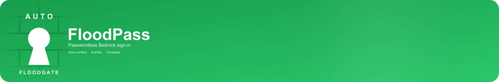

# FloodPass
---

[English](https://github.com/Dalict/FloodPass/blob/main/README.md)

AuthMe 附属 AuthMe Floodgate Auto Login（基岩版自动登录），让基岩版玩家进入 AuthMe + Geyser + Floodgate 方案的 Java 服务器无需输入密码

---

## 插件定位

离线服务器通常用 AuthMe 保护生存账号，这对 Java 玩家没问题。但是如果你的服务器加入了互通，通过 Geyser + Floodgate 方案让基岩版玩家可以加入，但是你的服务器是离线的，使用了 AuthMe 进行了密码验证，明明 Floodgate 已经验证了身份，还要要求基岩版玩家输入登录或注册密码，等于多此一举。

因此，FloodPass 就补上了这个问题：

- **对基岩玩家**：从头到尾什么都不用输。已注册的账号在进服约一秒后自动登录；全新玩家静默地以随机密码注册并直接登录
- **对 Java 玩家**：无任何影响，照常走 AuthMe 原有流程
- **前缀兼容**：带 Floodgate 前缀的基岩名（如 `.Steve`）无需改动 AuthMe 的 `allowedNicknameCharacters` 默认正则即可进服——只豁免真正的 Floodgate UUID，正则对 Java 玩家照常生效
- **与 /premium 共存**：基岩玩家的游戏 ID 与已启用正版验证（`/premium`，AuthMe 6.x + PacketEvents）的 Java 账号同名时，基岩侧照常进服、Java 侧保留免密正版登录——一个名字两种身份，互不冲突
- **preJoin 对话框自动放行**：即使 AuthMe 6.x 开启了阻塞式 preJoin 对话框（`settings.registration.dialog.preJoin`），FloodPass 也会通过 AuthMe 自带 API 为已验证的基岩玩家放行——基岩玩家不会被密码框卡住，AuthMe 配置无需改动）

**Floodgate 认证的玩家，FloodPass 直接放行，不经过 AuthMe 密码登录**

---

## 基岩版玩家加入的效果图

---

## 兼容性

| 组件        | 要求                                    | 说明                                        |
| --------- | ------------------------------------- | ----------------------------------------- |
| 服务端       | Spigot / Paper / Purpur / Folia 1.13+ | Java 8 字节码；更老的传统服务端（1.8+）一般也能加载，未测试       |
| Folia     | 支持                                    | 通过反射使用实体调度器，其他环境自动回退全局调度器                 |
| AuthMe    | 5.2+（v3 API）                          | **AuthMeReloaded**；已在 5.6.x 与 6.0.x 上验证。 |
| Floodgate | 2.x                                   | 加载期硬依赖（`depend`）                          |

> 另外 FloodPass 不是代理插件，但也能在您的代理形式服务器上使用，详情请阅读 https://github.com/Dalict/FloodPass/blob/main/WIKI_CN.md#代理网络velocity--bungeecord

## 依赖插件

| 插件                                                                                                                               | 是否必需 | 版本   | 用途                                          |
| -------------------------------------------------------------------------------------------------------------------------------- | ---- | ---- | ------------------------------------------- |
| [Floodgate](https://geysermc.org/download/floodgate/)                                                                            | 必需   | 2.x  | 通过 Xbox Live 验证基岩玩家身份，是 FloodPass 所有功能的信任基础 |
| [AuthMe](https://www.spigotmc.org/resources/authmereloaded.6269/)（官方 [AuthMeReloaded](https://github.com/AuthMe/AuthMeReloaded)） | 必需   | 5.2+ | FloodPass 为基岩玩家登录的目标登录插件；推荐尽量使用官方版          |
| [PacketEvents](https://github.com/retrooper/packetevents)                                                                        | 可选   | 2.x  | 仅在使用 AuthMe 6.x 正版验证（`enablePremium`）时需要    |

> Geyser 本身不是 FloodPass 的插件依赖——基岩连接可以来自任意 Geyser 部署形态（独立端或代理端），但 Floodgate 插件必须运行在本服务器上。

> **非常适用于官方版 AuthMe。** FloodPass 面向原版
> [AuthMeReloaded](https://github.com/AuthMe/AuthMeReloaded)（5.x / 6.x），
> **也适用于已内置 Floodgate 自动登录的分支**（如
> [AuthMeReReloaded](https://github.com/HaHaWTH/AuthMeReReloaded)）——
> 基本上也能用，能带来免注册收益。因为功能默认为关闭, 如果要使用内置的请勿使用 FloodPass 

---

## Wiki & 反馈

- Wiki: https://github.com/Dalict/FloodPass/blob/main/WIKI_CN.md
- 反馈: https://github.com/Dalict/FloodPass/issues

希望这个插件能帮助大家哦~我也是为了使用官方版 AuthMe，但我的服务器是互通，才制作它的。有什么问题尽量反馈哦，谢谢啦！ouo